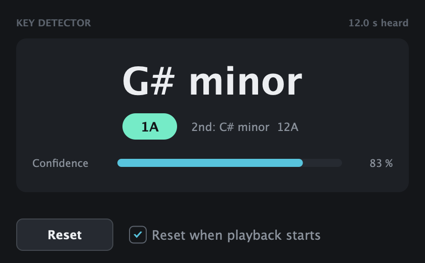
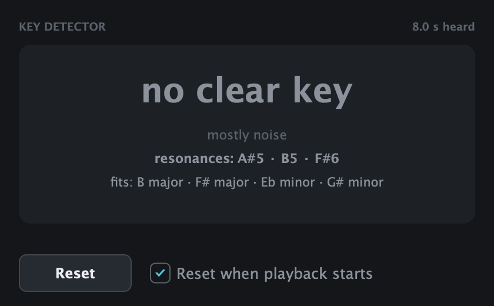
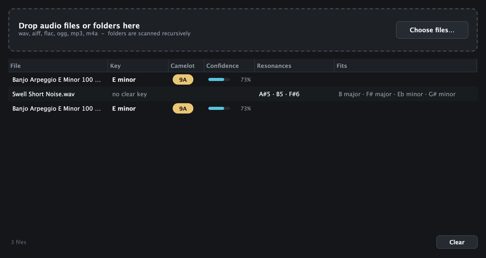

# audio-key-detector

Detects the musical key of audio: **inside your DAW** as a VST3/AU plugin, as a small
**drag-and-drop app** for sample folders, and as a **command line tool**. Key, Camelot code and a
confidence value; noise, drums and FX are reported as "no clear key" instead of a made-up key.

The analysis is done by [Essentia](https://essentia.upf.edu)'s `KeyExtractor` (HPCP + key profile
"shaath"); see [docs/ALGORITHM.md](docs/ALGORITHM.md) for the details and the measured accuracy.
macOS on Apple Silicon only for now. **Prebuilt binaries are not provided yet** - build from
source as described below (about five minutes).

## Key Detector plugin (VST3 / AU)



The plugin listens to the audio of the track it sits on and shows its key. The audio passes
through unchanged (no latency, no processing).

**In Ableton Live:**

1. Drag **Key Detector** from the browser (Plug-Ins, folder Tobias Barthold) onto the audio track.
2. Play the clip. After 2 seconds of audio the key appears, e.g. **A minor**, Camelot **8A**,
   plus the second-best key and a confidence bar. The result is updated every second and
   covers the last 60 seconds the track played.
3. Read the key. **Reset** forgets what was heard and starts over; with "Reset when playback
   starts" (on by default) this happens automatically each time you start the transport.

Tips: solo the clip if other clips on the same track play too; for a whole song, let it play
for a while (or put the plugin on the master track). Works the same in FL Studio (Mixer slot) or
any other VST3/AU host.

States: "listening..." (less than 2 s of non-silent audio so far), the key, or "no clear key"
(mostly noise: drums, risers, noise sweeps). For "no clear key" the plugin still shows what can
be said about the sound: its strongest **resonances** as notes (e.g. `A#5 · B5 · F#6`) and the
major/minor keys that **fit** them (`B major · F# major · Eb minor · G# minor`), so a riser or
swell can be tuned to the track. Nothing is shown if there is no prominent resonance.



## Key Detector app



`~/Applications/Key Detector.app`: drop audio files or whole folders on the window (or use
**Choose files...**) and get one row per file with key, Camelot code and confidence. Folders are
scanned recursively; wav, aiff, flac, ogg, mp3, m4a and caf are read. Hover over a row for the
second-best key, double-click to copy "A minor (8A)". "No clear key" rows list the resonances and
fitting keys in two extra columns. The app uses the same analysis code as the plugin.

## Install from source

Requirements: macOS 11+ on Apple Silicon, Xcode (or the Command Line Tools), CMake 3.22+ and
Ninja (`brew install cmake ninja`).

```
git clone https://github.com/tobiasbarthold/audio-key-detector
cd audio-key-detector
plugin/install.sh
```

The script downloads JUCE 8.0.17, Essentia (pinned commit) and Eigen 3.4.0 (checksums are
verified), builds everything in `build/plugin`, signs the results ad hoc and installs them for
the current user:

* `~/Library/Audio/Plug-Ins/VST3/Key Detector.vst3`
* `~/Library/Audio/Plug-Ins/Components/Key Detector.component` (AU, type `aufx`, code `Kdet`,
  manufacturer `Tbkd`; `auval -v aufx Kdet Tbkd` passes)
* `~/Applications/Key Detector.app`

Then rescan the plug-ins in your DAW (Ableton: Settings > Plug-Ins > Rescan). Uninstall by
deleting those three items.

## Command line tool

Python 3.9 or newer (Essentia provides wheels for macOS arm64 and Linux):

```
pipx install git+https://github.com/tobiasbarthold/audio-key-detector
```

or from a clone: `pip install .` (preferably in a venv). This installs `essentia`, `numpy`,
`scipy` and `soundfile`.

```
$ keydetect "Banjo Arpeggio E Minor 100 bpm.wav" "Swell Short Noise.wav"
Banjo Arpeggio E Minor 100 bpm.wav
  E minor  (9A)  confidence 0.73  |  2nd: A minor (8A)
Swell Short Noise.wav
  no clear key  (mostly noise; best guess B major)
  resonances: A#5 · B5 · F#6
  fits: B major · F# major · Eb minor · G# minor
```

```
keydetect <files or folders...> [--json] [--profile shaath|edma|bgate]
```

* Folders are scanned recursively for wav / aif / aiff / flac / mp3 / m4a / ogg.
* Per file: key, Camelot code, confidence 0..1, second-best key. `--json` adds Essentia's raw
  `strength`, the `tonality` used for the noise gate and the reason for "no clear key".
* For "no clear key" also the `resonances` (note names with octave, strongest first), their
  `resonance_hz`, the `fits` (keys containing those notes) and `fits_partial`; empty otherwise.
* MP3 and M4A are decoded through macOS `afconvert` (or `ffmpeg` if installed). Files are only
  read; nothing is written next to them.
* Exit code 1 if any file could not be read.

## Accuracy and limits

On the 35 factory loops of Ableton Live 12 Suite whose file names state a key, the detected key
matches the name for **24 (69 %)**, and 26 (74 %) including the relative major/minor. The
previous, self-made algorithm of this project reached 51 % / 57 % on the same files. On 48 chord
stabs and instrument one-shots with a named key: 29 (60 %) / 30 (62 %). Details, the other
Essentia profiles and how to reproduce the numbers: [docs/ALGORITHM.md](docs/ALGORITHM.md).

* File names in sample packs give the producer's root note, which is not always the harmonic key.
* **Relative major/minor** (same notes, e.g. A minor / C major) and **tonic vs. dominant** are
  the typical confusions - check the second-best key.
* The confidence is only a rough hint; wrong results can have high confidence.
* Heavily distorted loops can be reported as "no clear key"; very short one-shots with a single
  note give that note's family of keys, not a real key.
* In the plugin, a looping clip can occasionally give a different result than the same file in
  the app (the analysis frames fall differently); see docs/ALGORITHM.md section 6.
* Assumes A = 440 Hz tuning and equal temperament; no modulation tracking (the plugin shows the
  key of the last 60 s).

## Development

```
python3 -m venv .venv && .venv/bin/pip install -e '.[dev]'
.venv/bin/python -m pytest

cmake -S plugin -B build/plugin -G Ninja -DCMAKE_BUILD_TYPE=Release && cmake --build build/plugin
.venv/bin/python plugin/tests/compare_vectors.py build/plugin/KeyDetectCli_artefacts/Release/KeyDetectCli
```

* `keydetect/` - Python package and CLI (the reference implementation).
* `plugin/` - JUCE plugin, app and the C++ engine (`Source/Engine/KeyEngine.cpp`);
  `cmake/Essentia.cmake` compiles the needed part of Essentia (no Gaia, TensorFlow, taglib,
  ffmpeg or yaml; FFT via Apple Accelerate).
* `tests/vectors/` - synthetic WAVs with the Python output; `plugin/tests/compare_vectors.py`
  checks the C++ engine against them or against the Python CLI on any folder.
  `KeyDetectorLiveTest` feeds files through the plugin's live analyzer,
  `KeyDetectorHostTest` loads the installed VST3/AU in a JUCE host, `KeyDetectorSnapshots`
  renders the plugin and app UI to PNG files.
* `scripts/eval_named_loops.py` - accuracy against key names in file names.

## License and credits

GNU Affero General Public License v3.0 - see [LICENSE](LICENSE). Copyright (C) 2026 Tobias
Barthold.

* **Essentia** - Copyright (C) 2006-2021 Music Technology Group, Universitat Pompeu Fabra;
  AGPL-3.0 (<https://github.com/MTG/essentia>). Used as the Python package and compiled from
  unmodified source for the plugin and app. If you use this in research, please cite Essentia:
  D. Bogdanov et al., "Essentia: an audio analysis library for music information retrieval",
  ISMIR 2013.
* **JUCE** 8 - AGPL-3.0 / commercial dual licence (<https://juce.com>).
* **Eigen** 3.4 - MPL-2.0 (header-only, required by Essentia's core).
* Key profiles: Shaath (2011), Faraldo et al. (EDMA, BGATE) as distributed with Essentia.
